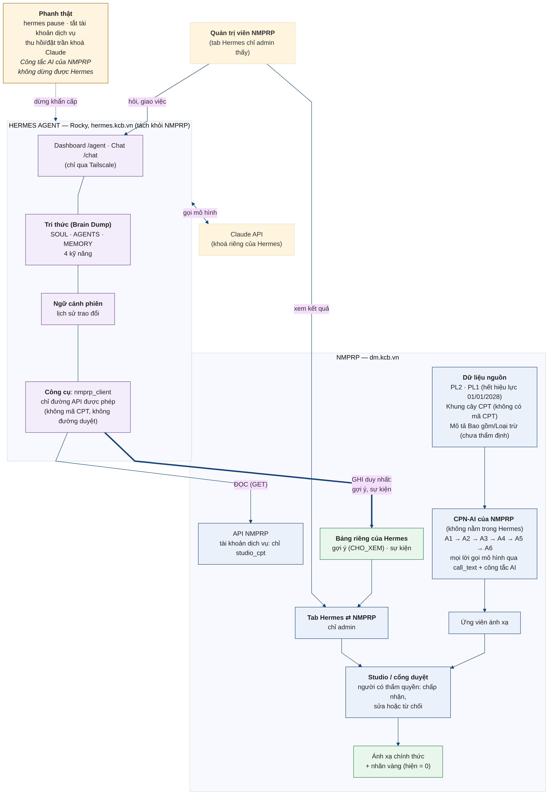

# NMPRP ⇄ Hermes Agent: sơ đồ kiến trúc tổng thể

Bản chỉnh từ sơ đồ phác thảo của chủ dự án (17/10/2026), đối chiếu với những gì đã xác minh. Nguồn vẽ: `docs/img/nmprp-hermes-kien-truc.mmd` (Mermaid); ảnh: `docs/img/nmprp-hermes-kien-truc.png`.

## Những chỗ đã chỉnh so với bản phác thảo
| # | Bản phác thảo | Bản chỉnh | Lý do |
|---|---|---|---|
| 1 | Sáu agent A1 đến A6 nằm trong khối Hermes | Nằm trong NMPRP (CPN-AI) | A1 đến A6 là worker của NMPRP, gọi mô hình qua `call_text` và chịu công tắc AI. Hermes ở ngoài, không chạy và không thay chúng. |
| 2 | Hermes nối thẳng vào cơ sở dữ liệu NMPRP và cổng ứng dụng | Hermes chỉ đọc qua API (danh sách đường cho phép) và chỉ ghi hai đường `goi-y`, `su-kien` vào bảng riêng | Tài khoản dịch vụ chỉ có `studio_cpt`; không đường duyệt, không bảng nguồn. |
| 3 | Hình thoi «Kết quả đủ tin cậy?»: Có thì chuyên gia duyệt, Không thì phản hồi | Mọi gợi ý đều chờ người duyệt; không có nút đủ căn cứ thì không gửi gợi ý và ghi sự kiện | Độ tin cậy chưa hiệu chuẩn (Gold Set = 0) nên không dùng làm cổng tự đi tiếp. |
| 4 | Telegram, Zalo, Discord, Web, Chat UI là kênh tương tác | Chỉ Dashboard `/agent`, Chat `/chat` (qua Tailscale) và tab Hermes trên NMPRP (admin) | Các kênh nhắn tin khác chưa được chủ dự án duyệt (brain dump câu 25: mặc định chỉ dashboard/admin). |
| 5 | Người dùng gồm chuyên gia, quản trị viên, cán bộ Cục/Bộ | Quản trị viên NMPRP | Chủ dự án chốt tab chỉ admin thấy. |
| 6 | Thiếu PL1 trong dữ liệu tham chiếu | Thêm PL1 (Phụ lục 1, hết hiệu lực 01/01/2028) | PL1 là danh mục kỹ thuật hiện hành, không phải danh mục giá. |
| 7 | Hệ thống mã tham chiếu ICD-9-CM, SNOMED CT | Bỏ khỏi sơ đồ | Chưa tích hợp; mã CPT không đi qua Hermes (bản quyền). |
| 8 | «Chạy agent chuyên môn», «Đọc file Excel/Word/PDF», «Tạo báo cáo» là công cụ của Hermes | Công cụ của Hermes là `nmprp_client` | Các khả năng kia chưa kiểm chứng hoặc không thuộc phạm vi thí điểm. |
| 9 | Vòng học: cập nhật quy tắc và prompt rồi ghi vào cơ sở dữ liệu | Hermes chỉ đề xuất bản vá kỹ năng; chủ dự án duyệt qua PR và đo trên nhãn vàng. Quyết định của người duyệt đi qua Studio | Học không được tự ghi vào dữ liệu hay đổi mặc định. |
| 10 | Thiếu Claude API và các phanh | Thêm Claude API (khoá riêng của Hermes) và khối «Phanh thật» | Công tắc AI của NMPRP không dừng được Hermes; phanh thật là `hermes pause`, tắt tài khoản dịch vụ, thu hồi hoặc đặt trần khoá Claude. |
| 11 | Hermes nằm trong NMPRP | Hermes chạy riêng trên Rocky (`hermes.kcb.vn`) | Hai hệ thống triển khai riêng, nối bằng API. |

Giữ nguyên từ bản phác thảo: khối Tri thức (Brain Dump), Ngữ cảnh phiên, chuỗi A1 đến A6, luồng dữ liệu nguồn đến ứng viên đến người duyệt, và vòng cải thiện có kiểm soát.
